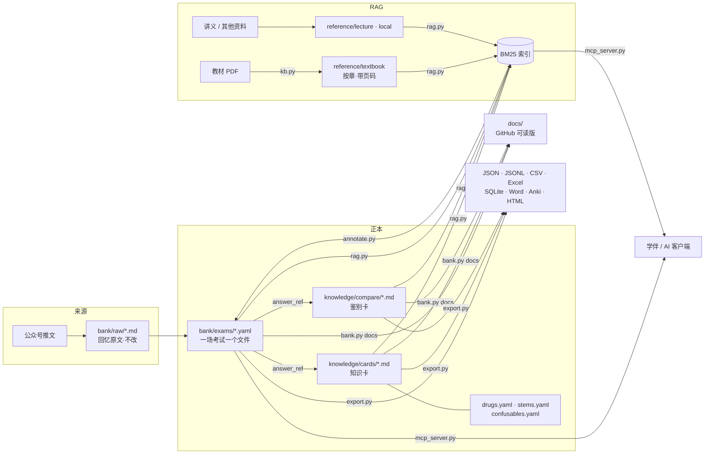

<div align="center">

# smart-pharmacology

## 复旦大学（上医）药理学 · 历年真题库与学伴

### 真题 → 答案与解析 → 知识卡 → 教材出处（本地 RAG）→ 多格式导出

#### [总览](docs/README.md) · [数据规范](bank/SCHEMA.md) · [安装](#2-安装) · [使用](#3-使用) · [系统设计](#4-系统设计) · [RAG](#5-rag教材出处) · [导出](#6-导出) · [协作](#7-协作与审核)

</div>

## 1 简介

本仓库把公众号“B1休息区”的 **fdsy药理学** 合集（2018–2024 级，临五 / 临八 / 药学 / 护理 / 口腔 / 预防；期中、期末、缓考、实验）整理成**可校验、可标注、可导出**的真题库，并为每道题挂上答案、解析、知识点和教材出处。

| 内容 | 数量 | 位置 |
|---|---|---|
| 考试（一场一个 YAML 文件） | 26 场 | [`bank/exams/`](bank/exams) |
| 题目 | 573 道 | 同上；可读版见 [`docs/exams/`](docs/exams) |
| 考后回忆原文（逐字保存，不改） | 26 篇 | [`bank/raw/`](bank/raw) |
| 知识卡（标准答案、评分要点、鉴别、构词） | 117 张 | [`knowledge/cards/`](knowledge/cards) |
| 鉴别卡（易混概念、同类药对比表） | 21 张 | [`knowledge/compare/`](knowledge/compare) |
| 药物（中英文、类别、别名） | 187 个 | [`knowledge/drugs.yaml`](knowledge/drugs.yaml) |
| 构词法词干（INN stems + 中文译字 + 易错点） | 82 个 | [`knowledge/stems.yaml`](knowledge/stems.yaml) |
| 易混药名组 | 22 组 | [`knowledge/confusables.yaml`](knowledge/confusables.yaml) |

**当前状态**：答案与解析均为 AI 草稿（`draft-ai`），**尚未人工审核，教材出处待标注**。进度见 [`docs/README.md`](docs/README.md)，每次提交后由 CI 校验。

> 题目来源声明：原推文注明“仅供学习交流，严禁商用”，版权归投稿人与公众号所有。本仓库代码采用 MIT 许可，题目数据不适用该许可。

## 2 安装

需要 Python 3.10+ 与 Git；导出 Word 需要 [pandoc](https://pandoc.org/installing.html)。

```bash
git clone https://github.com/rachael1216/smart-pharmacology.git
cd smart-pharmacology
python3 -m venv .venv && source .venv/bin/activate      # Windows：.venv\Scripts\activate
pip install -r tools/requirements.txt
python tools/bank.py check                                # 应输出“✓ 错误 0”
```

接入 MCP 客户端（Claude Code 等）：

```bash
claude mcp add smart-pharm -- "$(pwd)/.venv/bin/python" "$(pwd)/tools/mcp_server.py"
```

在客户端输入 **菜单** 开始。

## 3 使用

| 我想… | 命令 |
|---|---|
| 看整体进度 | `python tools/bank.py stats` |
| 搜题 | `python tools/bank.py find 首过` |
| 看一道题（答案已展开） | `python tools/bank.py show 24-pharm-final-019` |
| 放入教材，建 RAG | `python tools/kb.py build 药理学.pdf --book "《药理学》第9版"` → `python tools/rag.py build` |
| 查教材原文与页码 | `python tools/rag.py search 氨基糖苷 耳毒性 --authoritative` |
| 给题目找出处 | `python tools/annotate.py suggest 24-pharm-final-019` → `annotate.py add … --pick 1` |
| 批量标注出处候选 | `python tools/annotate.py auto --all -k 1` |
| 导出 Word 答案解析册 | `python tools/export.py docx --mode key --merge` |
| 导出 Excel / Anki / JSON / SQLite / 离线网页 | `python tools/export.py all` |
| 编辑后校验并更新可读版 | `python tools/bank.py check && python tools/bank.py docs` |

### 一道题长什么样

```yaml
- id: 24-pharm-final-020
  num: 20
  section: 简答题
  type: short_answer
  stem: 解救急性有机磷酸酯类中毒时，为什么必须同时使用阿托品和碘解磷定？
  completeness: full
  answer_ref: [op_poisoning#为何必须合用, op_poisoning#解毒药及机制]   # 引用知识卡小节，改一处、各年同步
  analysis: 核心：阿托品只对 M 样症状有效、不能复活酶；解磷定复活 AChE 并缓解 N 样症状……
  kp: [op_poisoning, atropine]
  evidence:                                 # 教材出处（RAG 候选 → 人工核对）
  - src: 《药理学》第9版
    loc: 第8章 胆碱酯酶抑制药和胆碱酯酶复活药 p.xx
    quote: ……
    status: 待核
  status: draft-ai                          # todo → draft-ai → draft → reviewed → verified
```

全部字段见 [`bank/SCHEMA.md`](bank/SCHEMA.md)。GitHub 上直接阅读请看 [`docs/exams/`](docs/exams)（由 `bank.py docs` 生成，答案折叠显示）。

## 4 系统设计



| 层 | 目录 | 职责 |
|---|---|---|
| 来源 | `bank/raw/`、`bank/sources.yaml` | 回忆原文与链接，可追溯 |
| 正本 | `bank/exams/`、`knowledge/` | 人和 AI 都只改这里；YAML / Markdown，diff 清楚 |
| 语料 | `reference/` | 教材、讲义、本地资料（不入库）；检索索引 |
| 工具 | `tools/` | 校验、检索、标注、导出；纯 Python，参数进、结果出 |
| 产出 | `docs/`（入库）、`exports/`（不入库） | 可读版与各种导出格式 |
| 协作 | `AGENTS.md`、`.agents/skills/`、`tools/mcp_server.py` | AI 助手的规则、流程与接口 |

### 4.1 为什么答案分 `answer` 与 `answer_ref`

“首过消除”在 13 场考试里出现过。它的标准答案只写在 `knowledge/cards/first_pass.md`，13 道题都用 `answer_ref: [first_pass]` 引用。改一处，所有年份同步；`bank.py check` 会报出任何失效引用。病例判断、选择题答案等本题特有内容写在 `answer`。

### 4.2 工具

| 工具 | 作用 |
|---|---|
| `bank.py` | `check` 校验（id、引用、状态、出处格式）· `stats` 覆盖率 · `show` / `find` · `fmt` 统一格式 · `docs` 生成可读版 |
| `kb.py` | 教材 PDF → 按“第X章”切分、保留页码（`--offset` 对齐纸书页码）；`list` / `show` / `find` |
| `rag.py` | 中文字二元组 + BM25 本地检索；语料带标签与出处；`--authoritative` 只查教材 / 讲义 / 本地资料 |
| `annotate.py` | 出处标注：`suggest` 候选 · `add` 写入 · `auto` 批量（待核）· `verify` 标记已核 · `card` 给知识卡找页码 |
| `export.py` | json / jsonl / csv / xlsx / sqlite / md / docx / anki / html；可按考试、年级、专业、题型、知识点、状态、语言筛选 |
| `mcp_server.py` | MCP 服务：`bank_find` `bank_show` `bank_stats` `bank_check` `rag_search` `annotate_suggest` `annotate_add` `export` |

### 4.3 构词法

`stems.yaml` 记录 82 个 INN 词干（如 `-olol` 洛尔 → β 阻断药），药物按英文名自动匹配词干。重点收录陷阱：`-mycin` 横跨氨基糖苷 / 大环内酯 / 糖肽 / 抗肿瘤；`-micin`（庆大霉素）与 `-kacin`（阿米卡星）；`-apine`（氯氮平）与 `-dipine`（地平类）；`sulfate` 不是磺胺 `sulfa-`。复旦药理考试英文药名比例高，导出的 Anki 卡组与离线网页都带“看英文名 → 说类别与机制”的练习。

## 5 RAG：教材出处

答案与解析的措辞应贴近课本、出处能翻回页码。做法沿用 [fdu-func-lab-helper](https://github.com/rachael1216/fdu-func-lab-helper)：

| 语料标签 | 位置 | 权威度 | 入库 |
|---|---|---|---|
| `textbook` | `reference/textbook/`（`kb.py` 由你的教材 PDF 生成） | 出处 | 否（版权） |
| `lecture` | `reference/lecture/`（讲义、PPT、笔记） | 出处 | 否 |
| `<目录名>` | `reference/local/<目录>/`（其他教材、执医资料等） | 出处 | 否 |
| `card` / `compare` | `knowledge/` | 整理物，不作出处 | 是 |
| `bank` | `bank/exams/` | 用于“以前怎么考” | 是 |

检索：中文取相邻汉字二元组、英文取小写词，BM25 排序（k₁ = 1.5，b = 0.75）；每个片段带出处定位（如“第2章 药物代谢动力学 p.12”）。`rag.py export` 可导出纯文本，交给向量检索（如 [local-rag-cpp](https://github.com/rachael1216/local-rag-cpp)）。

标注流程：

```bash
python tools/kb.py build 药理学第9版.pdf --book "《药理学》第9版（杨宝峰，陈建国 主编）" --offset 12
python tools/rag.py build
python tools/annotate.py auto --all -k 1 --min-score 8     # 写入候选，status: 待核
python tools/bank.py show 24-pharm-final-020               # 逐题核对
python tools/annotate.py verify 24-pharm-final-020         # 核对无误 → 已核
```

## 6 导出

| 用途 | 命令 |
|---|---|
| 打印模拟卷（无答案） | `python tools/export.py docx --mode paper --exam 24-pharm-final` |
| 答案解析册 | `python tools/export.py docx --mode key --merge` |
| 只导出已审的大题 | `python tools/export.py docx --mode key --type essay,short_answer --status reviewed,verified --merge` |
| Excel（题目、知识点考频、药物、构词法、易混药名） | `python tools/export.py xlsx` |
| Anki 卡组 | `python tools/export.py anki` |
| 给前端 / 大模型 | `python tools/export.py json` / `jsonl` |
| SQL 查询（含 `v_kp_frequency`、`v_need_evidence` 视图） | `python tools/export.py sqlite` |
| 离线网页浏览器 | `python tools/export.py html` |

产物在 `exports/`（不入库）。每次推送后，CI 会自动导出全部格式并作为 Actions artifact 提供下载。

## 7 协作与审核

1. 按 [`docs/README.md`](docs/README.md) 的“知识点考频”从高到低认领知识卡；
2. 对照教材修订卡片与题目，挂出处（`annotate.py`），把 `status` 改为 `reviewed`，`reviewer` 填 GitHub 用户名；
3. `python tools/bank.py check && python tools/bank.py docs`，提交 PR；CI 通过后合并。

AI 助手的工作规则见 [`AGENTS.md`](AGENTS.md)；流程见 [`.agents/skills/`](.agents/skills)（答疑、解析标注、录入、审核、导出）。

## 8 已知问题

- [ ] 全部答案与解析待人工审核；教材出处待放入教材后标注。
- [ ] `20-lin5-midterm` 原文为 47 张截图，仅有答案序列，题干与选项需看图补录。
- [ ] 多数选择题只回忆了考点，缺选项（`completeness: stem_only`）。
- [ ] 名词解释多数未单独写解析（答案由知识卡提供）。
- [ ] 标“存疑”或“按授课口径确认”的条目需对照授课 PPT：`grep -rn "存疑\|口径" bank knowledge`。
